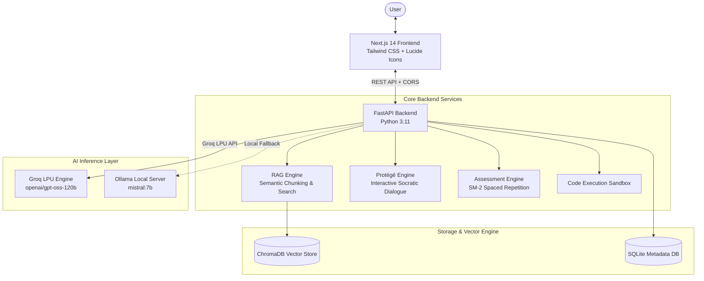

# 🧠 GuruCortex — Next-Gen AI Learning OS

> **An Intelligent, Multimodal Learning Platform powered by Retrieval-Augmented Generation (RAG) and Groq LPU High-Speed Reasoning.**

[](https://zenforge-frontend.wonderfulfield-6d6f3fba.centralindia.azurecontainerapps.io)
[](https://zenforge-backend.wonderfulfield-6d6f3fba.centralindia.azurecontainerapps.io/docs)
[](https://nextjs.org/)
[](https://python.org/)
[](https://groq.com/)
[](https://docker.com)

---

## 🌐 Live Production Deployments (Microsoft Azure)

| Service | Environment | Live URL |
| :--- | :--- | :--- |
| **Frontend Application** | Azure Container Apps | [https://zenforge-frontend.wonderfulfield-6d6f3fba.centralindia.azurecontainerapps.io](https://zenforge-frontend.wonderfulfield-6d6f3fba.centralindia.azurecontainerapps.io) |
| **Backend API (FastAPI)** | Azure Container Apps | [https://zenforge-backend.wonderfulfield-6d6f3fba.centralindia.azurecontainerapps.io](https://zenforge-backend.wonderfulfield-6d6f3fba.centralindia.azurecontainerapps.io) |
| **Interactive API Docs** | Swagger / OpenAPI | [https://zenforge-backend.wonderfulfield-6d6f3fba.centralindia.azurecontainerapps.io/docs](https://zenforge-backend.wonderfulfield-6d6f3fba.centralindia.azurecontainerapps.io/docs) |

---

## 🚀 Overview

**GuruCortex** is a comprehensive, production-grade learning operating system designed to dramatically accelerate knowledge retention, comprehension, and mastery.

By uniting **FastAPI**, **Next.js 14**, **ChromaDB**, and the ultra-low latency **Groq LPU inference engine**, GuruCortex enables students and professionals to interact with complex documents, test their understanding via adaptive quizzes, visualize core concepts through automated diagrams, and learn by teaching an AI pupil.

---

## 🌟 Key Features

### 1. ⚡ Groq LPU High-Speed Deep Reasoning
- **Primary Reasoning Model:** Powered by `openai/gpt-oss-120b` (Deep Reasoning & Thinking Process) with `openai/gpt-oss-20b` fallback.
- **Thinking Process Trace:** Real-time visibility into the AI's internal reasoning chain (`> 🧠 Thinking & Reasoning Process`) before delivering the final response.
- **Offline / Local Fallback:** Supports local execution through **Ollama** (`mistral:7b`) for 100% air-gapped, privacy-first environments.

### 2. 📚 Intelligent Multi-Format RAG
- **Document Ingestion:** Full extraction support for PDF, DOCX, PPTX, and TXT files.
- **Semantic Vector Retrieval:** ChromaDB vector storage with `sentence-transformers` embeddings (`all-MiniLM-L6-v2`).
- **Verifiable Citations:** Responses cite exact document sources, pages, and excerpts to eliminate hallucinations.

### 3. 👨‍🏫 Protégé Effect Mode (Learning by Teaching)
- Scientific research demonstrates that teaching is the most effective learning mechanism.
- The AI adopts the role of an eager, curious student who asks thoughtful questions and challenges your explanations to surface knowledge gaps.

### 4. 📊 Automated Visualizations & Mind Maps
- Automatically translates complex study topics into **Mermaid diagrams**, flowcharts, and mind maps directly inside the chat interface.

### 5. 🎯 Adaptive Assessments & Spaced Repetition (SM-2)
- Auto-generates multiple-choice, true/false, and short-answer quizzes based on uploaded study materials.
- Utilizes the **SuperMemo-2 (SM-2)** algorithm to schedule reviews precisely when memory retention is predicted to decay.

### 6. 👁️ Multimodal Attention & Voice
- **Attention Tracking:** Optional webcam-based focus detection using MediaPipe and OpenCV to gauge engagement during study sessions.
- **Voice Synthesis & Transcription:** Browser-native speech recognition and natural voice playback.

### 7. 💻 Interactive Code Sandbox
- Run, test, and debug code snippets live inside the browser with immediate execution feedback.

---

## 🏗️ Architecture



---

## 🛠️ Tech Stack

- **Frontend:** Next.js 14 (App Router), React 18, TypeScript, Tailwind CSS, Lucide React, Cytoscape.js.
- **Backend:** FastAPI, Python 3.11, Uvicorn, Gunicorn, Pydantic v2.
- **AI & RAG:** Groq API (`openai/gpt-oss-120b`), Ollama, ChromaDB, Sentence-Transformers, LangChain splitters.
- **Infrastructure & Cloud:** Microsoft Azure Container Apps, Azure Container Registry (ACR), Docker.

---

## 🚦 Getting Started Locally

### Prerequisites
- **Node.js** 18.x or later
- **Python** 3.11 or later
- **Git**

### Method 1: One-Click Windows Launcher
Double-click `run-dev.bat` in the project root. It will:
1. Activate the Python virtual environment and start FastAPI on port 8000.
2. Launch Next.js on port 3000.
3. Automatically open `http://localhost:3000` in your default browser.

---

### Method 2: Manual Setup

#### 1. Clone the Repository
```bash
git clone https://github.com/ABHISHEK-DBZ/gurucortex.git
cd gurucortex
```

#### 2. Backend Setup
```bash
cd backend

# Create and activate virtual environment
python -m venv .venv
source .venv/bin/activate  # On Windows: .venv\Scripts\activate

# Install dependencies
pip install -r requirements.txt

# Configure environment variables
cp .env.example .env
# Edit .env and set your GROQ_API_KEY

# Start backend server
python -m uvicorn app.main:app --host 127.0.0.1 --port 8000 --reload
```
The backend will be available at: `http://localhost:8000` (API Docs: `http://localhost:8000/docs`).

#### 3. Frontend Setup
```bash
cd ../frontend

# Install dependencies
npm install

# Start development server
npm run dev
```
The frontend will be available at: `http://localhost:3000`.

---

### Method 3: Docker Compose
```bash
# Start both frontend and backend in isolated containers
docker compose up -d --build
```

---

## ⚙️ Environment Variables

Create a `backend/.env` file with the following configurations:

```ini
# Application
DEBUG=true

# AI Provider Configuration
LLM_PROVIDER=groq
GROQ_API_KEY=your_groq_api_key_here
GROQ_MODEL=openai/gpt-oss-120b
GROQ_FALLBACK_MODEL=openai/gpt-oss-20b
INCLUDE_THINKING_IN_CHAT=true

# Local Fallback (Ollama)
OLLAMA_BASE_URL=http://localhost:11434
OLLAMA_MODEL=mistral:7b

# Embeddings & RAG
EMBEDDING_MODEL=all-MiniLM-L6-v2
TOP_K_RETRIEVAL=4
SIMILARITY_THRESHOLD=0.3
```

---

## 📡 API Reference Overview

| Endpoint | Method | Description |
| :--- | :--- | :--- |
| `/api/v1/health` | `GET` | Health check endpoint returning API operational status |
| `/chat/query` | `POST` | RAG-powered query with verified citations & thinking trace |
| `/documents/upload` | `POST` | Upload and vectorize study materials (PDF, DOCX, TXT) |
| `/protege/start` | `POST` | Initialize Protégé mode interactive learning session |
| `/assessments/generate` | `POST` | Auto-generate adaptive quizzes and flashcards |
| `/planner/generate` | `POST` | Generate customized curriculum and study schedules |
| `/code/execute` | `POST` | Execute Python code in a sandboxed runtime |
| `/multimodal/analyze-attention`| `POST` | Process webcam frame for attention tracking |

---

## 🛡️ Security & Privacy
- **Zero Hardcoded Secrets:** Credentials, API tokens, and sensitive keys are managed exclusively via environment variables and never checked into source control.
- **Air-Gapped Local Mode:** Fully supports local-only execution using Ollama for environments requiring strict data residency and compliance.

---

## 👥 Contributors & License

- **Author / Maintainer:** Abhishek ([@ABHISHEK-DBZ](https://github.com/ABHISHEK-DBZ))
- **License:** Licensed under the [MIT License](LICENSE).
