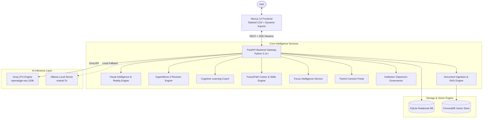

# 🧠 GuruCortex 2.0 — Next-Gen AI Learning OS

> **A Production-Grade, Local-First AI Learning Companion powered by Real-Time Token Streaming, Concept-to-Reality Grounding, SuperMemo-2 Spaced Repetition, and Cognitive Growth Analytics.**

[](http://localhost:8000/docs)
[](https://nextjs.org/)
[](https://python.org/)
[](docs/SECURITY_AND_TESTING.md)
[](https://groq.com/)
[](LICENSE)

---

## 🚀 Overview

**GuruCortex 2.0** is an enterprise-ready, local-first learning operating system engineered to transform raw study materials into intuitive mastery, practical engineering grounding, and lifelong retention.

Built with **FastAPI**, **Next.js 14 (App Router)**, **SQLite**, and **Groq LPU / Ollama inference**, GuruCortex 2.0 delivers token-by-token real-time streaming, scientific spaced repetition (SuperMemo-2), real-world concept-to-reality connections, parent telemetry, and institutional classroom governance.

---

## 🌟 GuruCortex 2.0 Core Capabilities

### 1. ⚡ Real-Time SSE Token Streaming
- Yields tokens in real time directly from Groq LPU or local Ollama instances via Server-Sent Events (`text/event-stream`).
- Built-in resilient offline token generator kicks in gracefully when external AI providers are unavailable.

### 2. 🔬 Visual Intelligence & Reality Engine
- **Concept Extraction:** Extracts core concepts, formulas, and principles from uploaded study materials.
- **Concept-to-Reality Navigator:** Bridges theoretical formulas with tangible engineering artifacts (e.g., semiconductor PN junctions, Tesla IGBT modules, satellite power systems) and renders ASCII circuit schematics.

### 3. 🧠 Revision Intelligence (SuperMemo-2)
- Implements the canonical SuperMemo-2 (SM-2) algorithm for optimal cognitive retention.
- Tracks individual flashcard states (`ease_factor`, `interval_days`, `next_review`), resets intervals on recall lapses ($q < 3$), and strictly enforces the $EF \ge 1.30$ floor.

### 4. 🧭 Cognitive Learning Coach & Growth Profile
- Analyzes study telemetry and quiz scores to identify cognitive bottlenecks (e.g., passive memorization, fatigue).
- Prescribes actionable learning strategies (Feynman technique, dual coding, active retrieval).
- Maintains a persistent student growth ledger tracking acquired technical skills and student engineering projects.

### 5. 🎯 FuturePath AI (Career & Skills Guidance)
- Maps academic subjects to high-demand industry job roles, compensation benchmarks, and technical requirements.
- Performs automated skill-gap analysis and generates milestone-driven roadmaps with estimated timelines.

### 6. ⏱️ Focus Intelligence & Session Tracker
- Logs deep-work study sessions with distraction counts and session productivity scores.
- Visualizes weekly focus distribution across active subjects.

### 7. 🛡️ Parent Connect Portal & Institutional Governance
- **Parent Connect:** Enables verified parents to review study consistency, active coach recommendations, and revision statistics via one-time 6-character linking codes. Strict IDOR protection prevents unauthorized student access.
- **Institution & Teacher Mode:** Role-Based Access Control (RBAC) enabling educators (`TEACHER`, `ADMIN`) to manage classrooms, assignments, and student cohorts.

---

## 🏗️ Architecture



For complete architectural details, see [docs/ARCHITECTURE.md](docs/ARCHITECTURE.md).

---

## 🚦 Getting Started Locally

### Prerequisites
- **Node.js** 18.x or later
- **Python** 3.11 or later
- **Git**

### 1. Clone the Repository
```bash
git clone https://github.com/ABHISHEK-DBZ/gurucortex.git
cd gurucortex
```

### 2. Backend Setup
```bash
cd backend

# Create and activate virtual environment
python -m venv .venv
source .venv/bin/activate  # On Windows: .venv\Scripts\activate

# Install dependencies
pip install -r requirements.txt

# Start backend server
python -m uvicorn app.main:app --host 127.0.0.1 --port 8000 --reload
```
API Documentation will be live at: `http://localhost:8000/docs`.

### 3. Frontend Setup
```bash
cd ../frontend

# Install dependencies
npm install

# Start development server
npm run dev
```
Open `http://localhost:3000` in your browser.

---

## 🧪 Automated Testing

GuruCortex 2.0 features a 37-test self-contained pytest suite verifying authentication, RBAC authorization, SuperMemo-2 mathematical invariants, failure recovery, and live API endpoints:

```bash
python -m pytest backend/tests/ -v
```

All tests run against isolated in-memory or temporary storage without requiring a running production server. For test suite documentation, see [docs/SECURITY_AND_TESTING.md](docs/SECURITY_AND_TESTING.md).

---

## ⚡ Performance & Bundle Optimization

Next.js 14 dynamic imports with fallback loaders are utilized for all heavy interactive modules in the dashboard:
- **Dashboard Initial JS:** Reduced from **287 kB to 252 kB** (12.2% reduction in initial payload).
- **Dashboard Page Chunk:** Reduced from **199 kB to 164 kB** (17.6% smaller chunk size).
- Zero compromise on usability with smooth loading spinners during lazy tab transitions.

---

## 📚 Documentation Index

- [System Architecture](docs/ARCHITECTURE.md)
- [API Reference](docs/API_REFERENCE.md)
- [Security Hardening & Testing Guide](docs/SECURITY_AND_TESTING.md)
- [Archived Migration Scripts](scripts/archive/README.md)

---

## 🛡️ Security & Privacy
- **IDOR Protection:** Relational parent-student linking verification on all telemetry endpoints.
- **RBAC:** Strict role checks (`STUDENT`, `PARENT`, `TEACHER`, `ADMIN`) on sensitive administrative endpoints.
- **Path Traversal Shield:** Document filenames sanitized and validated within root upload boundaries.
- **Rate Limiting:** Sliding-window rate limiters on sensitive linking endpoints.

---

## 👥 License
Licensed under the [MIT License](LICENSE).
