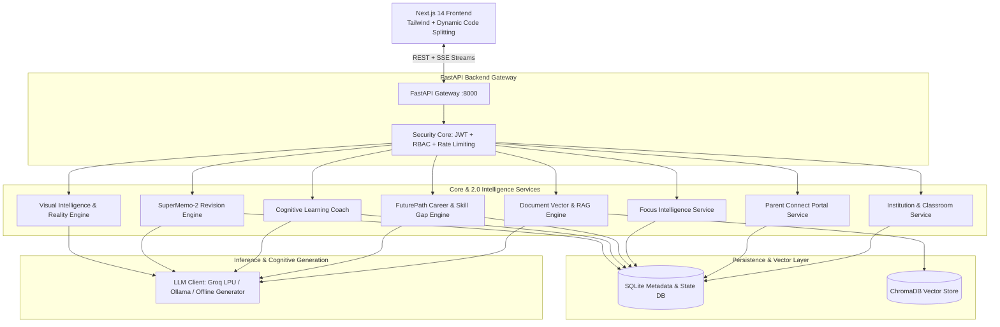

# GuruCortex 2.0 — System Architecture

## 1. High-Level Architecture Overview

GuruCortex 2.0 is an enterprise-grade, local-first AI Learning Operating System. It pairs a **FastAPI backend** (Python 3.11+) with a **Next.js 14 frontend** (App Router, Tailwind CSS, TypeScript) and provides real-time Server-Sent Events (SSE) streaming, spaced-repetition cognitive memory scheduling, concept-to-reality grounding, role-based access control (RBAC), and offline resilience.

---

## 2. Intelligence Engines

### 2.1 Visual Intelligence & Concept-to-Reality Grounding
- **Concept Extraction:** Analyzes document text and extracts core physical/computational concepts into typed knowledge units.
- **Visual Breakdown:** Generates structural visual breakdowns, formulas, physical analogies, and practical constraints.
- **Reality Grounding Engine:** Bridges theoretical equations with actual engineering artifacts (e.g., semiconductor PN junctions, Tesla IGBT modules, satellite power systems) and generates interactive ASCII circuit diagrams.
- **Real-Time Token Streaming:** Delivers token-by-token explanation streams directly to the browser via Server-Sent Events (`text/event-stream`).

### 2.2 Revision Intelligence Engine (SuperMemo-2)
- Implements the canonical SuperMemo-2 spaced repetition algorithm:
  $$I(1) = 1, \quad I(2) = 6, \quad I(n) = I(n-1) \times EF$$
  $$EF' = EF + (0.1 - (5 - q) \times (0.08 + (5 - q) \times 0.02))$$
- Supports recall quality ratings from 0 (total blackout) to 5 (perfect recall).
- Automatically resets repetition intervals to 1 day on recall failures ($q < 3$).
- Enforces an absolute floor for Ease Factor ($EF \ge 1.30$).

### 2.3 Cognitive Learning Coach & Identity Tracking
- Ingests student behavioral logs, quiz outcomes, and focus scores to diagnose cognitive bottlenecks (e.g., cognitive fatigue, passive reading traps, formula memorization without intuition).
- Generates personalized remedial strategies (Feynman technique, dual coding, retrieval practice).
- Maintains a persistent Student Growth Identity tracking acquired skills, practical engineering projects, and self-directed challenges.

### 2.4 FuturePath AI (Career & Skills Guidance)
- Maps academic subjects (e.g., Electronics, Computer Science, Biotechnology) to industry job roles, average salary ranges, and essential technical competencies.
- Evaluates student masteries against target career profiles to identify skill gaps.
- Synthesizes personalized step-by-step milestone roadmaps with estimated completion timelines.

### 2.5 Focus Intelligence & Session Logging
- Monitors real-time session duration, break frequency, and deep-work consistency.
- Automatically calculates weekly productivity scores and streak statistics.
- Computes focus distribution across active study modules.

### 2.6 Multi-Role Governance (Parent & Institution)
- **Parent Connect:** Enables parents to link with student accounts via one-time 6-character linking codes. Strict IDOR protection ensures parents only view telemetry for students explicitly linked to their profile.
- **Institution & Teacher Mode:** Enforces role-based permissions (`TEACHER`, `ADMIN`) to manage classrooms, publish assignments, and review aggregate student performance distributions.

---

## 3. Database Schema Overview

All persistent entities are stored in `backend/app/services/database.py` using SQLite with foreign keys enabled (`PRAGMA foreign_keys = ON`):

1. `concept_reality_nodes`: Theoretical concepts, real-world applications, engineering components, ASCII schematics.
2. `flashcard_decks`: Collection groupings for spaced repetition flashcards.
3. `smart_flashcards`: Individual cards with SM-2 states (`ease_factor`, `interval_days`, `repetitions`, `next_review`).
4. `flashcard_reviews`: Historical log of review submissions and recall ratings.
5. `coach_recommendations`: Remedial learning interventions and execution statuses.
6. `student_growth_profiles`: Persistent skills ledger, learning milestones, and self-directed projects.
7. `focus_sessions`: Deep-work tracking records with distraction counts and productivity metrics.
8. `parent_profiles` & `parent_student_links`: Family guardianship relationships and verification status.
9. `student_link_codes`: Secure 6-character short-lived link authorization tokens.
10. `institutional_classrooms` & `classroom_enrollments`: Educator classrooms, assignments, and student rosters.

